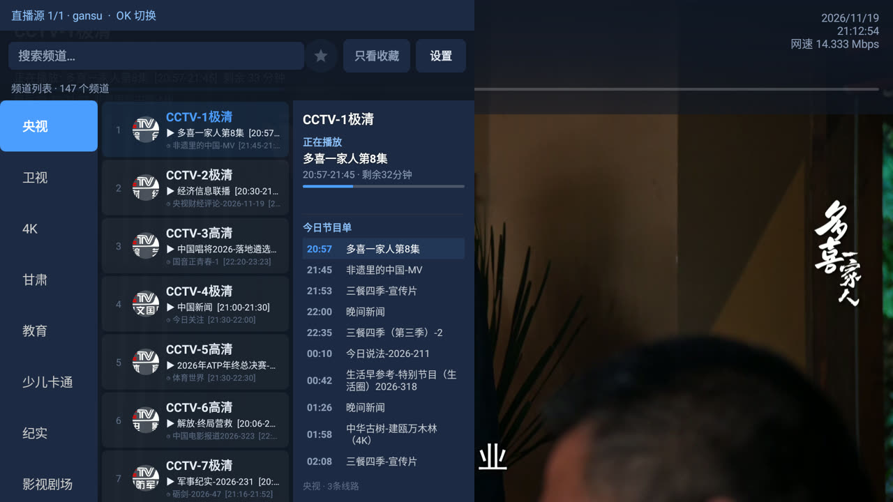
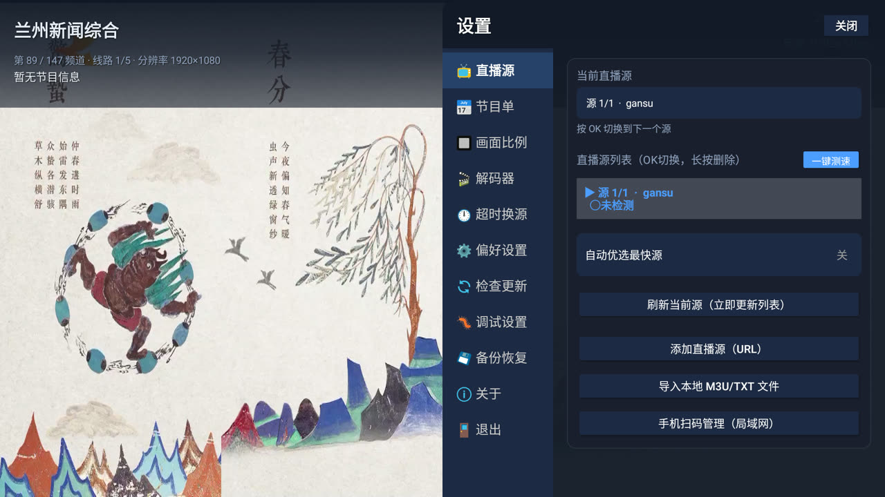
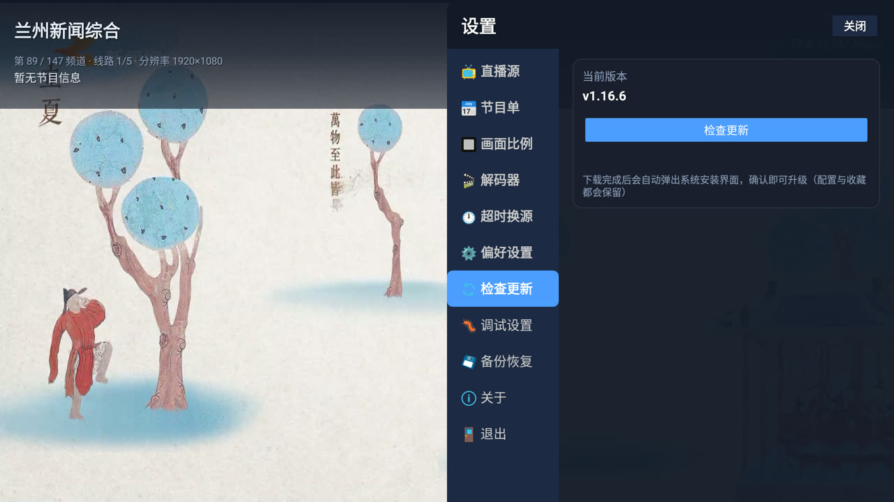

<div align="center">

# 揽星 TV

**Android TV / 电视盒子上的开源 IPTV 播放器**

Media3 ExoPlayer 内核 · M3U/TXT 源管理 · XMLTV 节目单 · 扫码配置 · 自动更新

<a href="https://github.com/cyj265/lanxing-tv/releases/latest"></a>
<a href="https://github.com/cyj265/lanxing-tv/actions/workflows/build-apk.yml"></a>
<a href="LICENSE"></a>


[下载最新版](https://github.com/cyj265/lanxing-tv/releases/latest) · [功能](#功能) · [遥控器操作](#遥控器操作) · [常见问题](#常见问题) · [自行构建](#自行构建)

</div>

---

> ⚠️ **本应用专为 Android TV / 电视盒子设计，使用遥控器操作。不支持手机触屏操作，请勿安装到手机。**

支持 **Android 6.0+（minSdk 23）**，老盒子也能装。播放内核使用 **Media3 ExoPlayer 1.11.1**（Google 官方播放器内核），对 HLS 直播流兼容性好，H.265/HEVC 高清源硬解。

## 界面预览

> 以下均为**真机截图**（1080p 盒子，公开测试流，仅作演示）。

| 全屏播放 | 频道列表（OK 键唤出） |
| :---: | :---: |
|  |  |
| **设置面板**（菜单键 / 列表内设置按钮） | **检查更新** |
|  |  |

## 亮点

- **为老盒子调过**：换台防抖、切后台只暂停不销毁播放器、硬解失败自动回退软解，尽量避开 Amlogic 等老芯片的解码器坑。
- **源出问题能自己救**：多源独立缓存、加载失败自动用上次缓存、超时自动换线路、一键测速并自动优选最快源。
- **配置不折腾**：机顶盒显示二维码，手机扫码即可在同一 Wi-Fi 下添加/切换源、设置节目单；换盒子前一键备份。
- **更新不掉配置**：直接覆盖安装，播放列表、收藏、解码方式与全部偏好保留。

## 功能

### 📺 播放

- **Media3 ExoPlayer 1.11.1** 内核，HLS 直播流兼容性好，H.265/HEVC 高清源硬解
- **自动识别流格式**：HLS (m3u8) / MPEG-TS / MP4 等
- **始终全屏播放**：画面不被频道栏遮挡，悬浮层按需唤出
- **画面比例**：原始 / 16:9 / 4:3 / 缩放裁剪 / 拉伸全屏
- **解码模式**：自动 / 仅硬件 / 仅软件，自动模式下硬解失败自动回退软解
- **切后台自动暂停**：离开前台立即停止解码与渲染（不销毁播放器，避免老盒子重新初始化黑屏），回到前台自动续播
- **自动恢复**：打开应用自动续播上次频道

### 📡 直播源管理

- **M3U / M3U8 / TXT 播放列表**：支持 URL 加载，也支持从本地文件导入
- **多直播源管理**：可同时配置多个源，在设置面板中切换；每个源独立缓存，加载失败自动用上次缓存
- **直播源健康度检测**：一键测速所有源的延迟，显示状态（正常/较慢/不可用）与延迟（ms）；支持「自动优选最快源」，测速后自动切到延迟最低的可用源
- **超时自动换源**：可设置超时时间（5~60 秒），当前线路加载超时自动切换下一条线路
- **上下键换台 / 左右键换线路**：全屏播放态上下键切频道，左右键切换当前频道的多条线路
- **扫码局域网管理**：机顶盒显示二维码，手机连同一 Wi-Fi 扫码即可在浏览器里添加/切换直播源、设置节目指南、直接播放（二维码带访问令牌，同网其他设备无法打开）

### 📅 节目单（EPG）

- **XMLTV 节目单**：顶部显示「正在播放/稍后播放」，频道列表中直接显示每个台当前节目
- **自动识别**：从播放列表头部的 `url-tvg` 自动预填节目单地址（未手动配置时）
- **定时刷新**：盒子常年不关机也不会停在开机那一刻（按设置里的刷新间隔，后台静默拉取）

### 🗂️ 界面与遥控

- **二级分组频道列表**：左栏为央视/卫视等分组，右栏显示对应分组的频道；支持搜索、收藏
- **收藏入口**：信息/收藏键、菜单键，或列表工具条上的星标
- **打开即定位**：唤出频道列表时自动滚动到当前播放的频道
- **双击返回退出**：连续按两次返回键弹出退出确认，退出后结束所有进程（后台无声音）

### 🔄 更新与运维

- **检查更新自动下载安装**：读取 GitHub 最新 Release，高于当前版本自动下载并拉起系统安装器
- **双线下载**：先直连 GitHub，失败自动切换 gh-proxy 加速中转
- **Android 8.0+ 安装引导**：首次更新会引导开启「允许安装未知应用」
- **配置备份/恢复**：设置面板单独一栏「备份恢复」，一键导出直播源、节目单地址、收藏、解码方式与全部偏好为 JSON；默认保存到应用目录并显示路径，恢复时直接列出应用内备份并高亮当前选择（无需系统文件选择器），也可另存到其他位置
- **崩溃日志导出**：真机问题一键导出 txt 发给开发者分析；启动时提示一次（不重复弹窗），日志可在调试设置中查看/导出/清理

## 下载与安装

1. 在 **[Releases](https://github.com/cyj265/lanxing-tv/releases/latest)** 下载最新 `iptv-player-vN.apk`（或从 **Actions** 页面最新一次构建的 Artifacts 下载）
2. 将 APK 复制到电视（U 盘 / Send files to TV / `adb install` 均可）
3. 电视上开启「允许安装未知来源应用」，安装即可
4. 如遇 Google Play Protect 提示「未知开发者」，选择「仍要安装」（本项目代码完全公开，可自行审计或构建）
5. 以后新版本**直接覆盖安装**，播放列表、收藏、配置全部保留

### 首次使用

打开应用后，按遥控器**菜单键**（或频道列表工具条里的**设置按钮**）进入设置 → 直播源，添加播放列表地址（M3U/M3U8/TXT），或用手机扫码快速添加。未添加播放源时界面会显示引导提示。

1. 设置 → **直播源**：填入播放列表地址，或点「导入本地文件」；可配置多个源并在列表中切换
2. 点「一键测速」检测各源延迟，开启「自动优选最快源」后自动切到最快源
3. 可选：设置 → **节目单** 填入 XMLTV 地址（支持多个，每行一个）；播放列表自带 `url-tvg` 且未手动配置过时会自动填入
4. 返回播放界面，按 **OK 键**唤出频道列表：左栏切分组，右键进频道，OK 播放
5. 也可在设置页点「扫码管理」，用手机扫码管理直播源与节目指南
6. 换盒子、重装或刷机前，先在**设置 → 备份恢复**点「备份配置」

> 本播放器**不内置任何直播源**，仅播放用户自行提供的播放列表。

## 遥控器操作

| 按键 | 功能 |
| --- | --- |
| 上 / 下 方向键 | 切换上 / 下一个频道（全屏播放态） |
| 左 / 右 方向键 | 切换当前频道的上 / 下一条播放线路 |
| OK / 确认键 | 唤出 / 收起频道列表（全屏播放态） |
| 菜单键 / 设置键 | 唤出 / 收起右侧设置面板（遥控器没有菜单键时，用频道列表工具条里的设置按钮） |
| CH+ / CH- | 切换上 / 下一个频道 |
| 播放 / 暂停键 | 播放 / 暂停 |
| 信息 / 收藏键 | 收藏（或取消收藏）当前正在播放的频道 |
| 返回键（双击） | 弹出退出确认，退出后结束所有进程 |
| 返回键（单击） | 关闭已打开的悬浮面板 |

> 连按上/下换台有 **260ms 防抖**：按住不放时只提示将切到的频道，松手后才真正起播，避免播放器被反复重建导致老盒子解码失败黑屏。

### 频道列表内操作

| 按键 | 功能 |
| --- | --- |
| 上 / 下 | 左栏分组中移动焦点，右栏频道随分组自动切换 |
| 右 | 焦点从左栏分组移到右栏频道列表（打开列表时已自动定位到当前播放的频道） |
| 左 | 焦点从右栏频道移回左栏分组 |
| OK（右栏频道） | 播放选中的频道 |
| OK（左栏分组） | 展开/收起分组，焦点自动移到右栏第一个频道 |
| 菜单键 | 收藏（或取消收藏）右栏当前焦点频道 |
| 上（移到工具条） | 星标＝收藏/取消收藏焦点频道；「只看收藏」＝筛选收藏频道（进入后按左右键可在星标、只看收藏、设置之间切换）；「设置」＝打开设置面板 |

### 设置面板内操作

| 按键 | 功能 |
| --- | --- |
| 上 / 下 | 左栏导航中切换分类（直播源/节目单/画面比例/解码/超时/偏好/更新/调试/备份恢复/关于/退出）；焦点在右侧时在设置项之间移动，到顶回左栏当前项 |
| 右 / OK | 焦点在左栏时进入右侧内容区，并定位到当前选中的值；同一行的多个选项之间用左右键切换 |
| 左 | 从右侧内容区最左侧回到左栏导航 |
| 返回 | 逐层退出：右侧内容区 → 左栏导航 → 关闭设置面板 |
| 菜单 / 设置键 | 关闭设置面板 |

## 支持的源格式

| 类型 | 说明 |
| --- | --- |
| M3U / M3U8 | 标准播放列表（URL 或本地文件） |
| TXT | 每行 `频道名,流地址`（支持中文逗号、纯地址行） |
| 直播链接 | 单个 http/https 流地址直接播放 |
| EPG | XMLTV 格式节目单（可选） |

## 常见问题

**装好后黑屏 / 一直没有画面？**
先确认播放列表地址在电脑上能打开；再在全屏态按左右键切换线路；仍不行可在设置 → 解码器切到「仅软件」。老盒子硬解能力不足时，HEVC 频道可能需要软解。

**提示「未知开发者」或被 Play Protect 拦截？**
选择「仍要安装」或「继续安装」。本项目源码公开，可在 Actions 页面核对构建产物，也可自行编译。

**某个频道一直加载失败，其他台正常？**
多半是该线路在当前网络不可用（运营商标记的源通常只在对应运营商网络内可播），换线路或换源即可，与播放器无关。

**点「检查更新」提示有新版本，但安装失败？**
Android 8.0+ 需要在系统设置里允许本应用「安装未知应用」；应用会在首次更新时引导开启。也可直接到 Releases 页面手动下载覆盖安装。

**更新后配置会丢吗？**
不会。覆盖安装保留播放列表、收藏与全部设置。换盒子或刷机前请先做一次「备份配置」。

**老盒子偶发花屏 / 解码失败，重启就好？**
部分 Amlogic 芯片的 HEVC 硬解会偶发初始化失败。应用会自动重试、换线路并回退软解；若仍异常，重启盒子或把解码器设为「仅软件」。

**怎么反馈问题？**
在设置 → 调试设置里导出崩溃日志（`app.log`），连同盒子型号、Android 版本与复现步骤一起提 Issue。

## 自行构建

### GitHub Actions（推荐）

推送到 `main` 分支会自动触发构建并发布 Release；也可以在 **Actions** 页面手动 Run workflow。

- 产物：`assembleRelease`，可直接侧载安装
- 每次构建生成唯一 tag `v<versionName>-b<构建号>`，指向当次源码 commit，便于按版本复现问题
- Release 只保留最近 3 个版本
- 构建失败时自动上传 `build.log` 工件（在对应运行页面底部下载），便于定位
- 纯文档改动（`**.md`、`LICENSE`、`docs/**`）不会触发构建

### 本地构建

需要 **JDK 17** + **Android SDK（compileSdk 36）** + **Gradle 8.9**（仓库自带 wrapper）：

```bash
# Windows
gradlew.bat assembleRelease

# macOS / Linux（首次需给 wrapper 可执行权限）
chmod +x gradlew && ./gradlew assembleRelease
```

APK 输出：`app/build/outputs/apk/release/app-release.apk`

> 本地构建使用 debug 签名或自备 keystore，与官方 Release 签名不同，**不能覆盖安装**官方包（会提示签名冲突），测试前请先卸载或使用自己的签名配置。

## 技术栈

| 组件 | 说明 |
| --- | --- |
| 语言 / UI | Kotlin 2.2.10 + AndroidX（AppCompat / RecyclerView / ViewBinding） |
| 播放内核 | Media3 ExoPlayer 1.11.1（HLS 专业支持，H.265/HEVC 硬解） |
| 局域网管理 | NanoHTTPD（内嵌 HTTP 服务） |
| 二维码 | ZXing |
| 构建 | AGP 8.7.3 / Gradle 8.9 / JDK 17 |
| 兼容 | minSdk 23（Android 6.0）/ targetSdk 34 / compileSdk 36 |

## 致谢

本项目参考了多个优秀开源项目的思路，部分思路已在代码注释中标明出处，特此致谢：

- 播放内核：[**Media3 ExoPlayer**](https://github.com/androidx/media)（Apache License 2.0）
- 界面图标：**Material Design Icons**（Apache License 2.0）
- 解码兼容性方案参考：[**lemonTV**](https://github.com/jia070310/lemonTV)（MIT License）——参考其开启解码器回退（Decoder Fallback）以兼容 H.265 高清源的配置思路；本项目代码为独立编写，未复制其源码
- 局域网管理服务：[**NanoHTTPD**](https://github.com/NanoHttpd/nanohttpd)（BSD 3-Clause）
- 二维码生成：[**ZXing**](https://github.com/zxing/zxing)（Apache License 2.0）

## 许可证

本项目采用 [**MIT License**](LICENSE) 开源，可自由使用、修改、分发与商用，请保留版权与许可声明。第三方依赖各自遵循其原有许可证。

## 免责声明

- 本项目**不提供、不托管、不推荐任何直播源或节目内容**，所有播放地址均由使用者自行添加。
- 请在遵守所在地法律法规与版权要求的前提下使用本项目；因使用第三方源或播放内容产生的任何责任，由使用者自行承担。
- 本项目仅供技术学习与个人使用。
